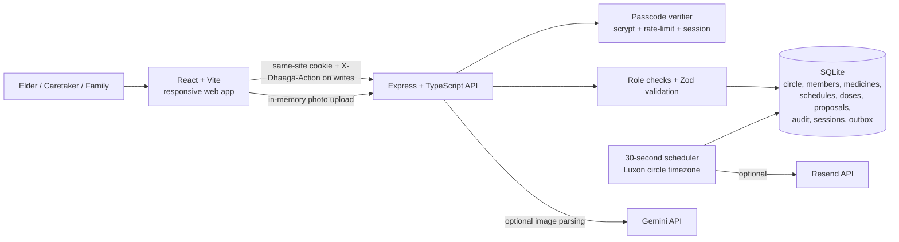

# Architecture

## Request and consent flow

1. A member enters a circle ID and the role’s six-digit passcode. The passcode is checked against a per-code salt and scrypt hash; successful sign-in creates a random server-side session with a signed, HTTP-only, SameSite=Lax cookie.
2. The API resolves the session to a member and circle. Role middleware protects each write. Requests that mutate state must also include `X-Dhaaga-Action`.
3. Medication and appointment changes are validated before applying. Caretaker medicine changes are proposals unless the elder enabled direct edits; appointment suggestions from caretakers/family remain proposals. Only an elder can approve or decline.
4. The scheduler evaluates dose and appointment windows in the circle timezone. It inserts emails with unique dedupe keys. With no Resend key, they remain visible in the outbox; with a key, the scheduler sends unsent rows.
5. Uploaded prescription images are validated in memory, used to create an editable draft, and discarded. They are never written to SQLite or disk.

## Storage

SQLite is the source of truth. `npm run seed` inserts the fictional Tulsi Circle and demo passcodes idempotently. `DHAAGA_DB` can point at another SQLite file; `:memory:` is supported for tests.
