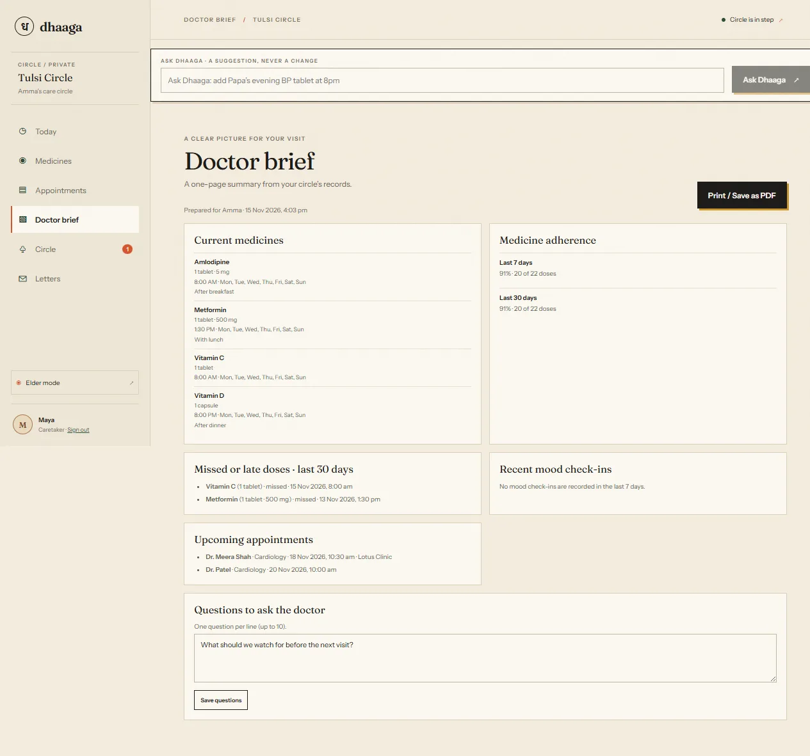
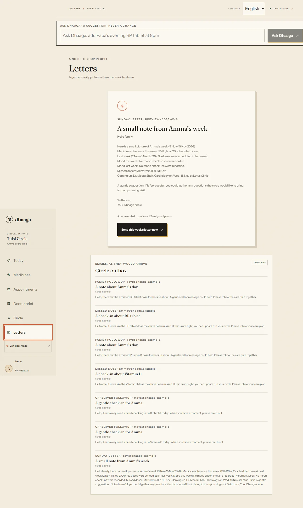
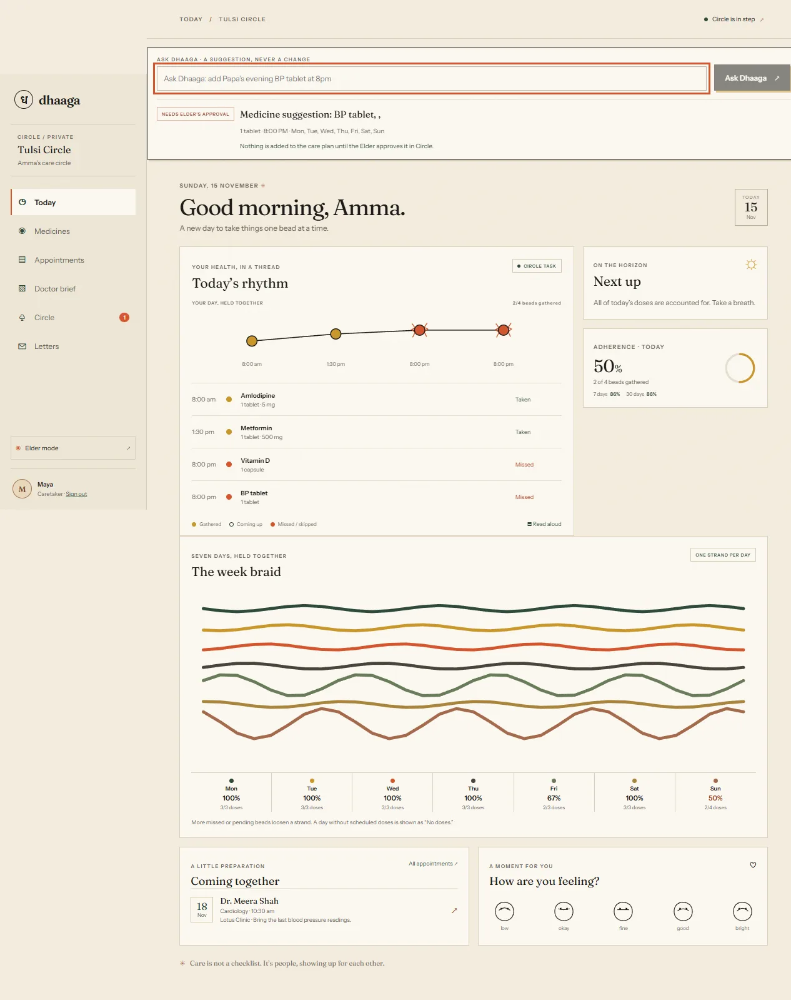
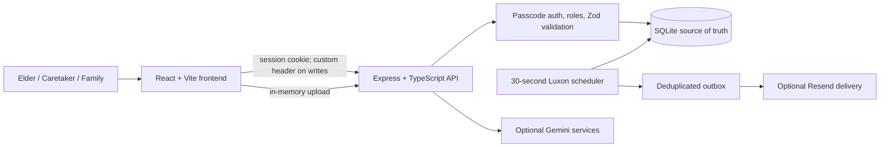

# Dhaaga (धागा)

**A shared care circle for an older adult, their caretakers, and family.**





## The problem and our approach

Older adults may have to keep track of medicines, appointments, and daily care routines while family and caretakers work from separate information. Dhaaga keeps those details in one passcode-protected circle with a shared day thread and reminders. Elders can manage their care and decide whether suggested changes are approved; caretakers and family can help without silently changing the plan. The dashboard also brings together adherence, appointments, check-ins, proposals, and a weekly family letter. Dhaaga supports coordination and does not provide medical advice.

## Quickstart

Requirements: Node.js 20+ and npm. No Gemini or Resend API key is required for local use; AI features use deterministic or editable fallbacks, and email is saved to the local outbox.

### Windows PowerShell

```powershell
git clone https://github.com/rajputpranav611-byte/dhaaga.git
Set-Location dhaaga
npm install
Copy-Item .env.example .env
node -e "const fs=require('node:fs');const crypto=require('node:crypto');const path='.env';const env=fs.readFileSync(path,'utf8').replace(/SESSION_SECRET=[^\r\n]*/, 'SESSION_SECRET='+crypto.randomBytes(48).toString('base64'));fs.writeFileSync(path,env)"
npm run seed
npm run dev
```

### macOS / Linux

```sh
git clone https://github.com/rajputpranav611-byte/dhaaga.git
cd dhaaga
npm install
cp .env.example .env
node -e "const fs=require('node:fs');const crypto=require('node:crypto');const path='.env';const env=fs.readFileSync(path,'utf8').replace(/SESSION_SECRET=[^\r\n]*/, 'SESSION_SECRET='+crypto.randomBytes(48).toString('base64'));fs.writeFileSync(path,env)"
npm run seed
npm run dev
```

Open [http://localhost:5173](http://localhost:5173). Development mode enables the demo. The API uses `data/dhaaga.sqlite`; without Resend configuration, queued messages are shown in the outbox.

## Two-minute demo

1. On the landing page, select **Caretaker** under “Step into the demo.” Demo codes are `Elder 111111`, `Caretaker 222222`, and `Family 333333`.
2. In the dashboard’s **Ask Dhaaga** field, submit a complete medicine suggestion such as `add Papa's evening BP tablet, 1 tablet, at 8pm every day`. Review the suggestion and the **Needs Elder’s approval** state; it is not applied directly.
3. Sign out and enter the demo as **Elder**. Open **Circle**, review the pending suggestion, and choose **Approve**.
4. On **Today**, use **Next dose** to advance the demo clock to a scheduled dose. This may also process seeded overdue doses. Use **+20 min** and **+45 min** while a dose remains unconfirmed to demonstrate caretaker and family follow-ups.
5. Open **Letters** (the `/outbox` page) and inspect the saved reminder messages and weekly-letter preview. The seeded circle contains fictional medicines, appointments, and dose history.

## Brief-to-feature traceability

| Brief statement | Implemented feature | Code |
|---|---|---|
| Help older adults manage daily medicines, appointments, and routines while keeping family and caretakers informed. | Shared dashboard, dose thread, appointment list, check-ins, and circle updates. | [`src/App.tsx`](./src/App.tsx), [`server/index.ts`](./server/index.ts) |
| Elder, caretakers, and family access one healthcare profile through passcode-based access. | Circle and role passcodes, salted scrypt hashes, login lockout, and signed sessions. | [`server/security.ts`](./server/security.ts), [`server/index.ts`](./server/index.ts) |
| Authorized members manage medication schedules, track adherence, and monitor upcoming appointments. | Role-checked medication and appointment routes, dose events, and adherence calculations. | [`server/index.ts`](./server/index.ts), [`server/domain.ts`](./server/domain.ts), [`server/db.ts`](./server/db.ts) |
| The system sends email reminders for missed doses, upcoming doses, and appointments. | 30-second scheduler, time-window reminders, escalation, unique dedupe keys, Resend delivery when configured, and the SQLite outbox fallback. | [`server/scheduler.ts`](./server/scheduler.ts), [`server/db.ts`](./server/db.ts) |
| Care should be smarter, accessible, reliable, collaborative, and centred on the elder’s decisions. | Elder approval for proposals, configurable direct caretaker medicine edits, interaction starter rules, Elder Mode, and audit history. Accessibility has not been certified; see limitations below. | [`server/index.ts`](./server/index.ts), [`server/domain.ts`](./server/domain.ts), [`src/App.tsx`](./src/App.tsx), [`SECURITY.md`](./SECURITY.md) |

## Evaluation evidence

| Criterion | Evidence |
|---|---|
| Code Quality | TypeScript strict settings in `tsconfig*.json`; Biome lint is run with `npm run lint`; API, database, validation, and scheduler code are separated under `server/`. |
| Security | `server/security.ts` implements salted scrypt verification, timing-safe comparison, lockout, and sessions; `tests/core.test.ts` exercises auth and role-sensitive flows; `npm audit` is included in final verification. |
| Efficiency | `server/db.ts` defines database indexes; `server/scheduler.ts` bounds scheduled work; Express compression and Vite asset caching are configured in `server/index.ts` and `vite.config.ts`. The production entry JavaScript is **76.38 KB gzipped**. |
| Testing | `npm test` contains **32 tests**; `npm run test:coverage` reports **79.41% statements, 65.54% branches, 84.03% functions, and 84.63% lines**. |
| Accessibility | Browser axe-core checks reported **0 violations** on the landing/login, Today dashboard, Medicines, Appointments, Doctor Brief, and Letters/outbox pages after the latest shared-style changes. `src/App.tsx` provides skip links, language document metadata, and labelled thread SVGs. |
| Problem Statement Alignment | Each sentence of the brief is mapped above to the UI, API, security, database, and scheduler modules. Each feature status below distinguishes complete flows from partial ones. |

## Architecture



### Folder map

- `src/` — React application, API client, and styles.
- `server/` — Express routes, SQLite schema, security, domain rules, scheduler, and optional AI services.
- `tests/` — workflow, security, validation, scheduler, and upload tests.
- `docs/screenshots/` — product screenshots.
- `ARCHITECTURE.md`, `SECURITY.md`, and `PROMPTS.md` — architecture, threat model, and product prompts.

## Security model

Role-scoped passcodes are stored as salted scrypt hashes; comparison is timing-safe. Login failures trigger rate limits and lockout. Authenticated requests use a signed, HTTP-only, SameSite=Lax session cookie, and state-changing requests require a custom header. API inputs are validated with Zod; database access uses parameterized SQL and circle-scoped queries. Prescription uploads are limited to 4 MB, MIME- and signature-checked, processed in memory, and not stored. Read the [threat model and known limits](./SECURITY.md) before using real health data.

## AI use and safeguards

When `GEMINI_API_KEY` is configured, Gemini can read a prescription image into an editable draft, rewrite interaction findings in plain language, parse Ask Dhaaga commands into structured data, and optionally polish a weekly letter. Zod validates structured prescription, interaction, and command outputs; Ask Dhaaga results remain proposals until Elder approval, and medicine suggestions run the offline interaction starter list. Prescription images are not stored. With no key, prescription flow returns a clearly editable placeholder draft, Ask Dhaaga uses a rule-based parser, interaction findings use curated local rules, and letters use a deterministic template. Weekly-letter polish checks numbers against the source data and falls back to the template if unsupported numbers appear.

## Feature status and limitations

| Feature | Status | Notes |
|---|---|---|
| Demo logins, role checks, passcode lockout, and shared profile | Done | Demo is enabled for local development; production configuration must disable it. |
| Medication schedules, dose status, adherence, and day thread | Done | Dose history and adherence are persisted in SQLite. |
| Appointment management, approval proposals, and audit history | Done | Family suggestions and caretaker changes follow the role/consent rules in the API. |
| Dose and appointment reminders, escalation, and outbox | Done | Delivery requires scheduler uptime; external email requires Resend configuration. |
| Prescription photo to editable schedule draft | Partial | No-key mode is a placeholder draft, not OCR; Gemini reading is assistive and not prescription verification. |
| Interaction checking | Partial | Curated starter rules are offline and non-exhaustive; they do not replace a clinician or pharmacist. |
| Daily check-in, Elder Mode, speech read-aloud, and EN/HI/GU labels | Partial | Core strings exist; Hindi and Gujarati need native-speaker review and translations are not comprehensive. |
| Sunday Letter and Doctor Brief | Done | Database-backed content; brief questions are editable by Elder/Caretaker; print uses the browser. |
| Ask Dhaaga | Done | Rule-based fallback or optional Gemini parser; uncertain results are editable and proposals require Elder approval. |
| Seven-day week braid | Done | Pure SVG with a text summary and reduced-motion styling. |
| Accessibility certification and Lighthouse score | Partial | Browser axe checks above are clean for the listed pages; no Lighthouse 90+ result or formal certification is claimed. |
| Diagnosis, treatment advice, or certified medical-device use | Not built | Dhaaga is a coordination tool, not a medical device. |

The app is not a certified medical device. The interaction list is not exhaustive. Hindi and Gujarati translations must be reviewed by native speakers. SQLite data is not encrypted at rest; protect the database, backups, logs, and host. Review [SECURITY.md](./SECURITY.md) before any deployment.

## Built with Google Antigravity

See the [product rules and prompts](./PROMPTS.md).
