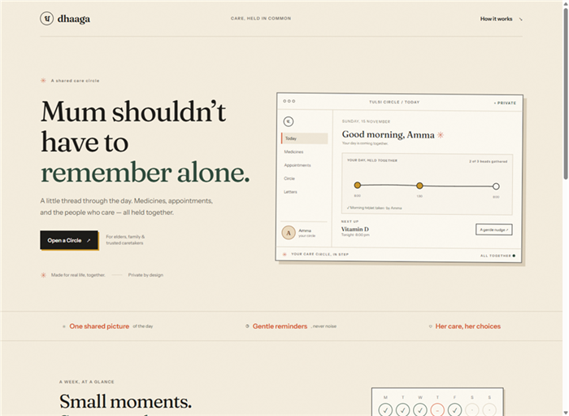
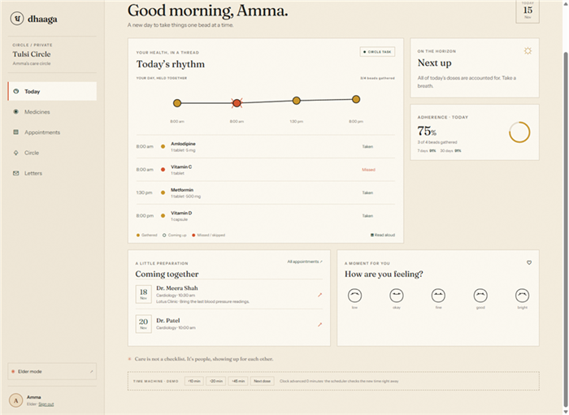

# Dhaaga (धागा)

**Hold the thread together.** Dhaaga is a shared care circle for an older adult, their trusted caretakers, and family. The daily thread puts medicine doses and appointments in one calm, shared view while keeping the elder in charge of changes.

## Run locally

Requirements: Node.js 20+ and npm.

```powershell
npm install
npm run seed
npm run dev
```

Open [http://localhost:5173](http://localhost:5173). Development mode enables the demo tools by default. The API uses a local SQLite database at `data/dhaaga.sqlite`. No API keys are needed.

To configure optional services, copy `.env.example` to `.env`. Set `RESEND_API_KEY` and `EMAIL_FROM` to deliver queued messages through Resend; without a key, messages remain in the database outbox. Set `GEMINI_API_KEY` to enable prescription-photo parsing and optional plain-language rewriting of interaction findings. The application stores neither uploaded photo nor API key in the database.

## Demo

Click **Enter demo as Elder / Caretaker / Family** on the landing page. Demo passcodes are shown only in development/demo mode:

| Role | Passcode |
|---|---:|
| Elder | `111111` |
| Caretaker | `222222` |
| Family | `333333` |

The fictional Tulsi Circle is seeded with medicines, a future visit, and a week of dose history including a missed dose. The Elder view includes a time machine; advancing it runs the reminder/escalation scheduler immediately. The Letters page shows the email outbox.

## Screenshots




## Roles

- **Elder:** views and manages the circle, marks doses, and approves or declines suggestions. The elder can allow direct caretaker medicine edits and configure the escalation timings.
- **Caretaker:** views the circle, manages medicines, marks doses, and suggests appointment changes. Medicine changes become proposals unless the elder enables direct editing.
- **Family:** views the circle and can suggest appointment changes. Suggestions do not apply until the elder approves them.

First-time members provide their name and email. The email is used for circle reminders.

## Feature status

“Done” means implemented in this repository; “Partial” means an explicit portion is present but the full brief is not yet implemented.

| Feature | Status | Notes |
|---|---|---|
| Circle passcodes, signed sessions, role checks, login lockout | Done | Shared six-digit code per role; first member entry records name and email. |
| Medication and appointment create/read/update/delete | Done | Caretaker/family edits are proposals where the role rules require consent. |
| Dose Taken / Skip, late status, today / 7-day / 30-day adherence | Done | Dose history is stored in SQLite. |
| Day-thread timeline, frayed missed beads, reduced-motion support | Done | Slack reflects the day’s adherence. |
| Elder approval cards and circle audit log | Done | Suggested changes do not apply until approved. |
| Upcoming/missed dose and appointment emails | Done | 30-second scheduler; Resend when configured, otherwise SQLite outbox; dedupe keys prevent repeats. |
| Escalation to caretaker and family | Done | Defaults are 20 and 45 minutes; elder can adjust them per circle. |
| Prescription photo to editable medication draft | Partial | JPEG/PNG/WebP, 4 MB max, in-memory only, with validated Gemini output or a deterministic no-key draft. The photo flow is an assistive draft, not prescription verification. |
| Interaction starter list | Done | Curated rules are explicitly non-exhaustive and direct the user to a doctor or pharmacist. |
| Daily mood check-in | Done | One-tap five-face mood and optional note. |
| Elder mode and read-aloud | Partial | Larger controls, high contrast, speech synthesis, and English/Hindi/Gujarati core-screen labels are present; translations need native review and coverage is not yet complete. |
| Sunday family letter | Partial | Letters shell and outbox are present; weekly summary generation/sending is not. |
| Doctor brief, Ask Dhaaga command bar, seven-day braid | Partial | Not implemented yet. |
| Mobile-first landing, keyboard focus, responsive dashboard | Done | Visual and browser smoke-checked; a formal WCAG audit is still recommended. |

Hindi and Gujarati UI strings are initial drafts and **must be reviewed by native speakers** before production use.

## Development

```powershell
npm test
npm run build
npm run seed
```

`npm run dev` starts the Vite frontend and Express API. The Vite server proxies `/api` to port 3001. `PORT`, `DHAAGA_DB`, `TZ`, `GEMINI_MODEL`, and the optional provider keys can be set in `.env`.

## Project map

- `src/` — React + TypeScript frontend and paper-and-ink design.
- `server/` — Express API, SQLite schema, auth, role checks, and scheduler.
- `tests/` — focused security, workflow, schema, and scheduler tests.
- `docs/` — architecture and screenshot evidence.

See [ARCHITECTURE.md](./ARCHITECTURE.md) for the service diagram and [SECURITY.md](./SECURITY.md) for the threat model and known limits.
